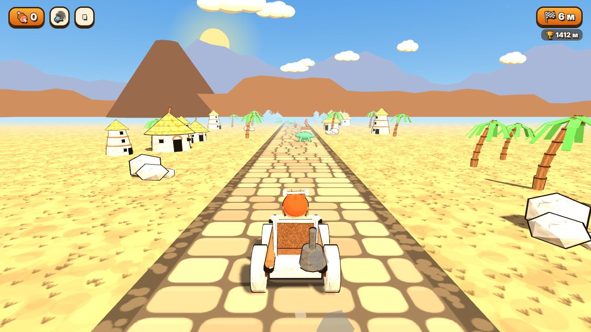
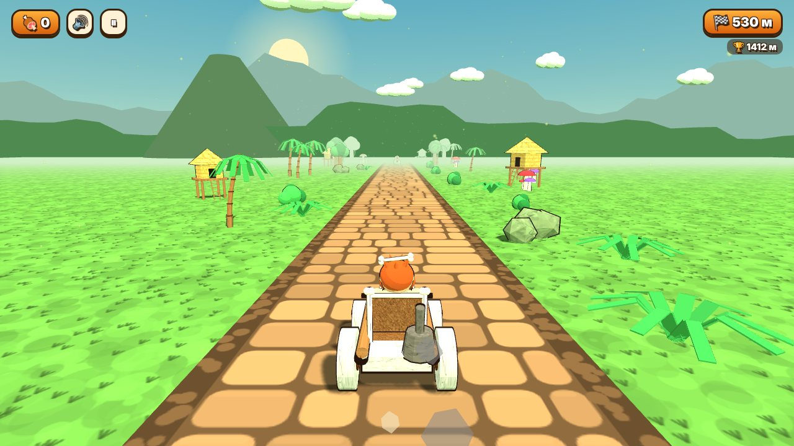
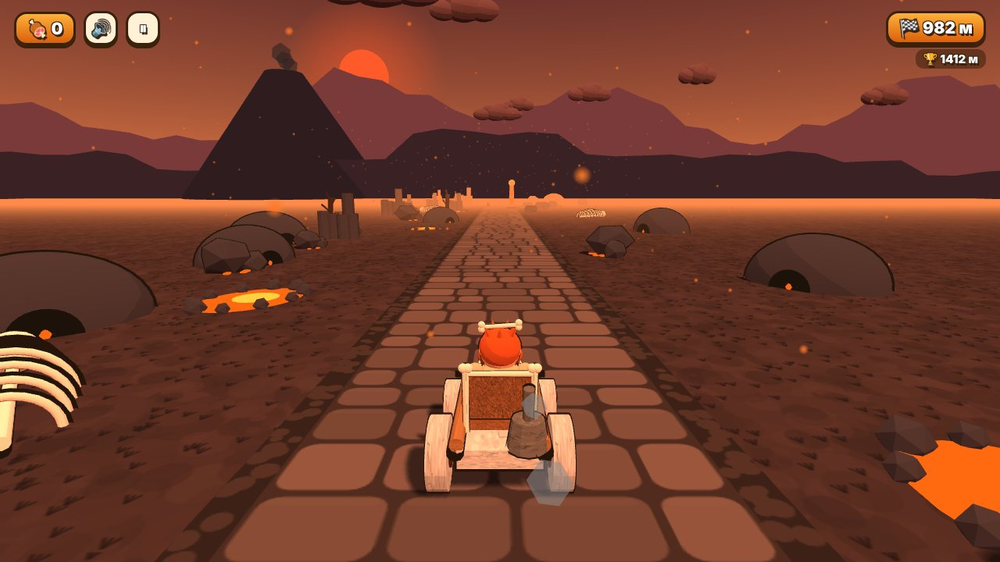
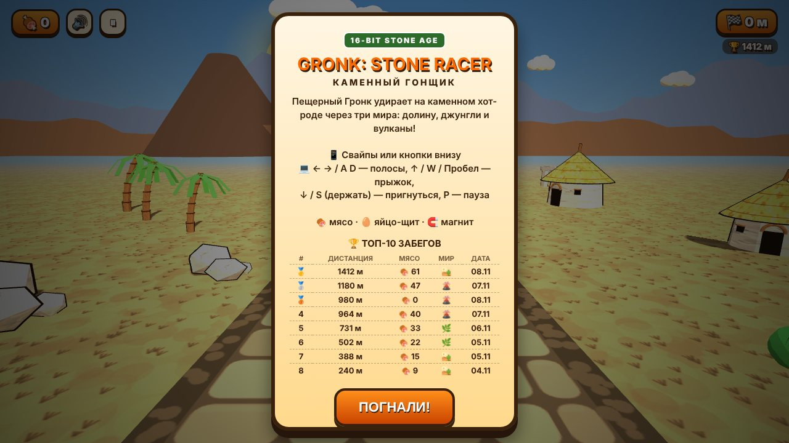
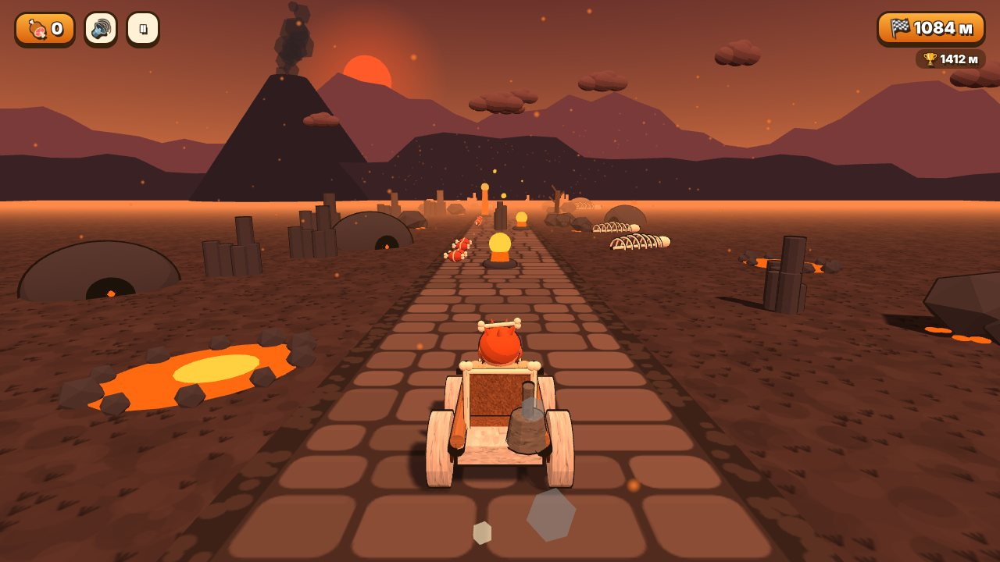

# 🦴 Gronk: Stone Racer

**Каменный гонщик** — браузерный 3D-раннер в стиле 16-битной эпохи. Пещерный Гронк на каменном хот-роде удирает через три доисторических мира, уворачивается от валунов, динозавров и лавовых гейзеров и собирает мясо.

**▶ Играть: https://v1p3rl0rd.github.io/gronk-stone-racer/**



| Папоротниковые джунгли | Огненные вулканы |
|---|---|
|  |  |

| Меню и таблица рекордов | Конец забега |
|---|---|
|  |  |

## Управление

| Действие | Клавиатура | Телефон |
|---|---|---|
| Сменить полосу | `←` `→` / `A` `D` | свайп влево/вправо или ◀ ▶ |
| Прыжок | `↑` / `W` / `Пробел` | свайп вверх или ▲ |
| Пригнуться (держать) | `↓` / `S` | свайп вниз или удерживать ▼ |
| Пауза | `P` / `Esc` | ⏸ |
| Старт / рестарт | `Enter` | кнопка на экране |

Пригибание в прыжке — быстрый спуск. Раскладка ЙЦУКЕН тоже работает.

## Миры и препятствия

Каждые 450 м мир сменяется: плавно перетекают небо, земля, свет и музыка.

| Мир | Препятствия | Окружение |
|---|---|---|
| 🏜️ Каменная долина | валуны, кактусы, брёвна, тотемы, смоляные лужи | хижины, каменные башни, пальмы, мегалиты |
| 🌿 Папоротниковые джунгли | пни, гигантские грибы, брёвна, смола | древовидные папоротники, хижины на сваях, грибы |
| 🌋 Огненные вулканы | лавовые гейзеры, лавовые ямы, базальтовые столбы, обгорелые брёвна | скелеты, лавовые озёра, пещеры, угли в воздухе |

Во всех мирах встречаются **птеродактили** (под ними нужно пригнуться — по тени на дороге видно полосу), **динозавры**, бродящие между полосами, и **поваленные деревья** поперёк всей дороги.

**Бонусы:** 🍖 мясо · 🥚 яйцо-щит (выдерживает один удар) · 🧲 магнит (притягивает мясо).

**Таблица рекордов:** топ-10 забегов (дистанция, мясо, мир, дата) хранится в `localStorage` браузера.

## Запуск локально

Сборка не нужна — это один HTML-файл и three.js.

```bash
git clone https://github.com/V1p3rL0rd/gronk-stone-racer.git
cd gronk-stone-racer
python3 -m http.server 8000   # затем открыть http://localhost:8000
```

Можно открыть `index.html` и напрямую двойным кликом.

## Технически

- **Three.js r128** (лежит в `vendor/`, без CDN — игра работает офлайн).
- Toon-шейдинг + контуры (inverted hull), градиентное небо на шейдере, процедурные canvas-текстуры.
- Модели собраны из примитивов кодом; шаблоны строятся один раз и клонируются (общая геометрия, без утечек памяти).
- Чиптюн-звук на Web Audio API: pulse-волна 25 %, треугольный бас, шумовые барабаны, планировщик по аудио-часам. Своя мелодия для каждого мира.
- Деплой на GitHub Pages через GitHub Actions (`.github/workflows/pages.yml`).

```
.
├── index.html                  # игра целиком (HTML + CSS + JS)
├── vendor/three.min.js         # three.js r128 (MIT)
├── docs/screenshots/           # скриншоты для README
└── .github/workflows/pages.yml # публикация на GitHub Pages
```

## Лицензия

[MIT](LICENSE). Three.js распространяется под MIT, см. [`vendor/THREE_LICENSE`](vendor/THREE_LICENSE).
